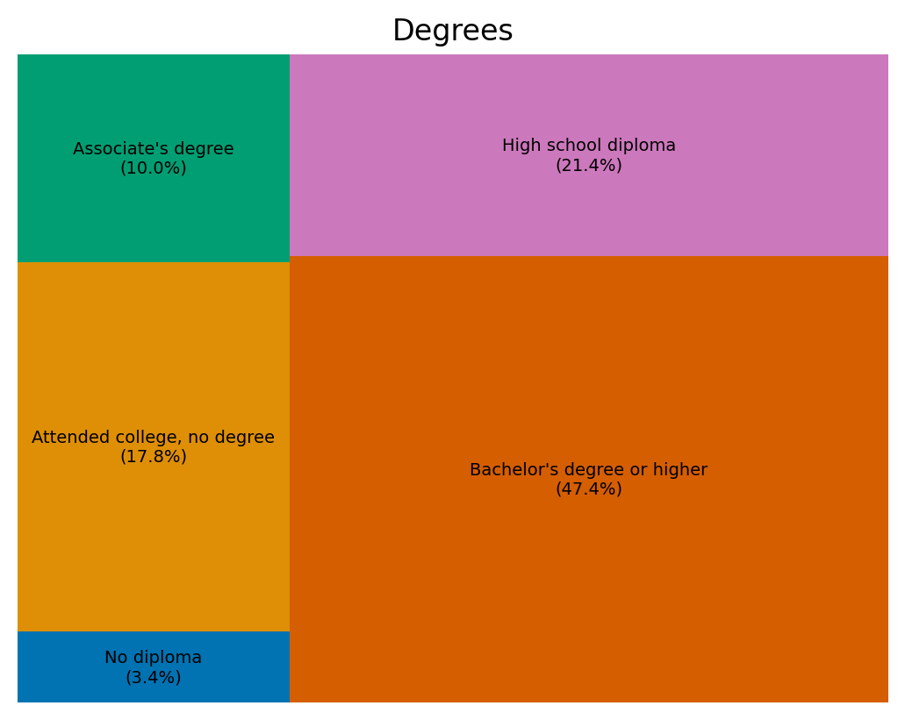

# Education, Annual Salary, and Weekly Working Hours

## Research question
How do education levels relate to annual salary and weekly working hours in the provided dataset?

## Dataset and usage
This educational exercise uses `data/age_salary_hours.csv` (500 records) with four fields: `Age`, `Annual Salary`, `Weekly hours`, and `Education`. The dataset was provided for the course exercise; its original source and sampling method are not specified here. Results should not be generalized to a wider population.

The **education composition** chart uses all 500 rows. For the two violin plots, the notebook filters to `Age < 65` (385 rows). No missing values were found in the four columns.

## Methods and tools
Python, pandas, numpy, matplotlib, seaborn, and squarify. The notebook counts education categories, calculates percentages, and visualizes the distributions of salary and weekly hours by education group. This is descriptive analysis, not causal inference.

## Key findings
- Bachelor's degree or higher is the largest education group: **237 of 500 observations (47.4%)**.
- Among records with age below 65, the **median annual salary** for the bachelor's-or-higher group is **61,000**, compared with **29,000** for the high-school-diploma group. The salary currency was not specified in the dataset.
- Median weekly working hours for the under-65 education groups range from **37 to 40 hours**, suggesting relatively small differences in group medians; their distributions still vary.

### Education composition

### Salary and weekly hours distributions (age below 65)

## Limitations
- Dataset provenance, geographic scope, salary currency, and sampling procedure are not supplied.
- Observational comparisons cannot establish that education causes salary or work-hour differences.
- Education groups have unequal sample sizes. Extremes and outliers may affect the shape of violin plots.
- The analysis excludes respondents aged 65 and above from salary and working-hours distributions, but not from the education-composition chart.

## How to reproduce
1. Download or clone this repository.
2. Install Python 3 and run `pip install -r requirements.txt`.
3. Start Jupyter using `jupyter notebook`.
4. Open `Activity7.06.ipynb` and run the cells in order.

The notebook reads `data/age_salary_hours.csv`, so launch Jupyter from the repository's root folder. The two images above are saved outputs from the notebook provided for the exercise.

## Project status
Completed classroom exercise, repackaged as a data science portfolio example.

## Privacy and permissions
No passwords, access tokens, or personal identifiers are included. **Before publishing the CSV publicly, confirm that the course-provided dataset is approved for public sharing.** If not, omit the CSV and explain the access restriction in this README.
